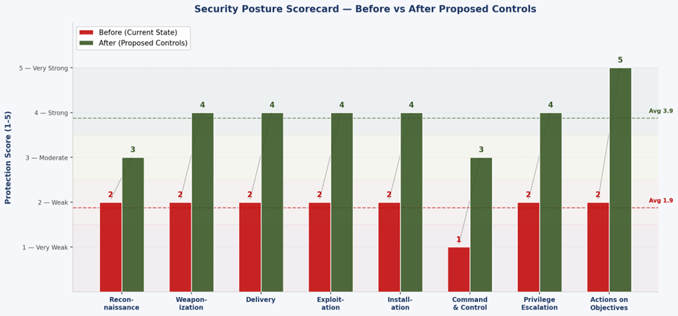

# Security Posture Evaluation Using the Cyber Kill Chain: LockBit Ransomware

University of Wollongong in Dubai (UOWD)  
CSIT302 Cybersecurity (Assessment 2: Report)  
Lecturer: Dr. Mouhannad Alattar  

Authors:
- Hriday Kumar (8890766)
- Sibi Parampil (8935166)
- Muhammad Yahya (8258168)
- Mohamed Shafeen (8303988)
- Abdirahman Mohamed (8690807)

## Overview

Ransomware continues to be one of the most disruptive cyber threats facing modern organizations. Modern ransomware operations, particularly Ransomware-as-a-Service (RaaS) variants such as LockBit, move far beyond simple malicious email attachments. Attackers methodically gain initial access, establish persistence, elevate privileges, move laterally across internal networks, and compromise backup infrastructure before deploying encryption payloads and extortion demands.

This project evaluates the security posture of an enterprise against a LockBit ransomware attack by applying Lockheed Martin's Cyber Kill Chain framework. Using a realistic fictional case study of a mid-sized organization (ABC Manufacturing Ltd), the report identifies critical architectural and procedural vulnerabilities at each stage of the attack lifecycle, and proposes a prioritized defense-in-depth mitigation plan and incident response playbook.

## Organizational Network Scenario: ABC Manufacturing Ltd

To ground the technical analysis in a realistic corporate environment, the report models ABC Manufacturing Ltd, an enterprise with approximately 300 employees running an on-premises Active Directory infrastructure.

### Baseline Environment Characteristics
- Active Directory domain managed by a single Domain Controller (DC01).
- Logical network separation between User LAN (192.168.10.0/24) and Server LAN (192.168.20.0/24) via a perimeter firewall.
- Remote access provided through an SSL-VPN portal without Multi-Factor Authentication (MFA).
- Centralized file sharing (FS01) and backup storage (BKUP01) hosted on the Server LAN, both joined to the Active Directory domain.
- Standard signature-based antivirus on employee workstations; no Endpoint Detection and Response (EDR) deployed.
- Windows Event Logging enabled on individual hosts, but without a centralized Security Information and Event Management (SIEM) system or log aggregator.
- Unrestricted outbound HTTPS traffic permitted through the perimeter firewall.
- Server Message Block (SMB, port 445) communication permitted across the entire network, with default administrative shares (C$, ADMIN$) accessible to domain machines.

## LockBit Attack Mapping to the Cyber Kill Chain

The table below outlines how a LockBit attack campaign targets the organizational environment, mapping each phase to relevant ports, event logs, MITRE ATT&CK techniques, and inherent risk levels.

| Kill Chain Phase | LockBit Attacker Activity | Ports / Protocols | Key Technical / Log Indicators | MITRE ATT&CK | Inherent Risk |
| :--- | :--- | :--- | :--- | :--- | :--- |
| Reconnaissance | Public scanning of VPN portal, RDP services, and employee email gathering via OSINT | TCP 443, 3389 | Firewall deny logs, repeated connection attempts | T1595 (Active Scanning) | High |
| Weaponization | Generation of malicious lures containing obfuscated PowerShell downloaders or payloads | Non-network | Compiled malicious documents or executables | T1566.001 (Spearphishing Attachment) | Medium |
| Delivery | Phishing emails sent to employees; brute-forcing or credential stuffing against exposed VPN/RDP | TCP 443, 3389 | Mail gateway logs, VPN authentication failure and success spikes | T1566 (Phishing), T1078 (Valid Accounts) | High |
| Exploitation | Execution of attachment payload; execution of encoded PowerShell commands | TCP 445 | Windows Event ID 4624 (Logon), PowerShell Script Block Logging | T1059.001 (PowerShell) | High |
| Installation | Persistence created on compromised workstation using scheduled tasks or registry Run keys | Local OS | Windows Event ID 4698 (Scheduled Task Created) | T1053.005 (Scheduled Task) | High |
| Command and Control | Outbound reverse shell and periodic beaconing to external attacker servers over HTTPS | TCP 443 | Outbound firewall connection logs, unusual external DNS queries | T1071.001 (Web Protocols) | High |
| Actions on Objectives | Mass file encryption via AES/RSA, deletion of Volume Shadow Copies (vssadmin), ransom note drop | Local OS / Storage | Event ID 4663 (File Access), vssadmin delete shadows commands | T1486 (Data Encrypted for Impact), T1490 (Inhibit System Recovery) | Critical |

## Realistic Attack Progression and Asset Exposure

The progression of the LockBit intrusion through ABC Manufacturing Ltd unfolds across five distinct stages:

1. Initial Access: Attackers obtain valid domain credentials through targeted phishing or VPN credential stuffing. Because VPN lacks MFA, attackers authenticate directly onto an employee workstation (WS01) on the User LAN (192.168.10.x).
2. Establishing a Foothold: A PowerShell script executes in memory, establishing persistence through a Windows Scheduled Task and maintaining a reverse HTTPS connection to external Command and Control (C2) servers.
3. Credential Dumping: Using tools such as Mimikatz, attackers dump cleartext passwords and NTLM hashes directly from the Local Security Authority Subsystem Service (LSASS) memory on WS01, capturing cached Domain Administrator credentials.
4. Lateral Movement: Armed with Domain Admin hashes, the attackers execute a Pass-the-Hash attack across the open SMB (TCP 445) path from User LAN to Server LAN, pivoting to both the file server (FS01) and backup server (BKUP01).
5. Domain Compromise and Ransom Deployment: With complete administrative control over DC01, attackers link a malicious Group Policy Object (GPO) to distribute and execute the LockBit payload across every domain-joined endpoint and server simultaneously, disabling shadow copies and encrypting production files and domain-joined backups.

## Identified Security Posture Gaps

An evaluation of ABC Manufacturing Ltd's baseline posture revealed four critical structural deficiencies:

### 1. Identity and Access Gaps
Single-factor VPN access means stolen or phished credentials grant immediate internal network connectivity without secondary verification. Lack of administrative tiering permits Domain Admin accounts to log onto low-trust workstations where credentials can be scraped from LSASS.

### 2. Network Segmentation and Traffic Controls
While User LAN and Server LAN exist as logical subnets, permissive firewall rules allow open SMB (port 445) communication between ordinary workstations and critical servers. Outbound HTTPS traffic is uninspected, allowing C2 beaconing to blend into regular web browsing.

### 3. Visibility, Logging, and Monitoring
Although Windows and network devices record events locally, the absence of a centralized SIEM prevents cross-system correlation. An attacker moving between the VPN, a workstation, and the Domain Controller leaves isolated log entries (Event IDs 4624, 4672, 4698) that go unnoticed until encryption occurs.

### 4. Backup Vulnerability and Recovery Architecture
The backup server (BKUP01) resides in the same Active Directory forest and trusts the same credentials as production servers. Consequently, a Domain Admin compromise instantly exposes backup repositories to deletion and encryption, leaving the organization with no reliable offline recovery mechanism.

## Proposed Defense-in-Depth Solutions

### Preventive Controls
- Multi-Factor Authentication: Enforce MFA on all external VPN, RDP, and administrative access points, neutralizing credential theft attacks (T1078).
- Network Segmentation and SMB Restrictions: Enforce strict VLAN filtering between user endpoints, servers, and management networks. Block workstation-to-workstation SMB (port 445) traffic and restrict administrative shares (C$, ADMIN$) to dedicated administrative jump hosts.
- Endpoint Hardening: Deploy an enterprise EDR solution with behavioral heuristics. Enable Windows Defender Credential Guard to protect LSASS memory, enable PowerShell Constrained Language Mode, and enforce least privilege using tiered administrative accounts (Tier 0, Tier 1, Tier 2).
- Immutable Offline Backups: Implement a strict 3-2-1 backup strategy. Decouple backup storage from the Active Directory domain and enforce immutable, write-once-read-many (WORM) offline storage to prevent ransomware from tampering with recovery data (T1490).

### Detective Controls
- Centralized SIEM Deployment: Aggregate logs from Windows endpoints, domain controllers, perimeter firewalls, VPN gateways, and DNS resolvers.
- Key Correlation Rules:
  - Alert on multiple failed VPN logins followed by an anomalous success from a new geographical location.
  - Alert on Windows Event ID 4698 (Scheduled Task Creation) coinciding with encoded PowerShell executions.
  - Alert on sudden surges in internal SMB traffic originating from non-administrative workstations.
  - Detect high-frequency outbound HTTPS beaconing to newly registered or unclassified external domains.

### Ransomware Incident Response Playbook
- Detection and Analysis: Confirm the scope of suspicious activity using SIEM alerts and EDR process trees (monitoring Event IDs 4663, 4672, and 4698). Identify affected user accounts and host IP addresses.
- Containment: Immediately isolate infected subnets and machines at the switch/firewall level. Disable compromised domain credentials and block external C2 IP addresses at the perimeter firewall.
- Eradication: Terminate unauthorized processes, remove scheduled tasks and persistence keys, reset all domain administrative passwords, and re-image confirmed compromised workstations.
- Recovery: Restore systems from verified immutable offline backups. Reconnect hosts to the network in controlled phases while running continuous EDR scans to prevent reinfection.
- Post-Incident Review: Conduct a formal lessons-learned session to update detection signatures, patch exploited entry points, and refine network access policies.

## Security Posture Scorecard: Before and After Proposed Controls

Each phase of the Cyber Kill Chain was scored on a 1 to 5 scale based on the effectiveness of controls in preventing, detecting, or mitigating LockBit activity (1 = Very Weak, 2 = Weak, 3 = Moderate, 4 = Strong, 5 = Very Strong).

| Kill Chain Phase | Before: Baseline Control | Before Score | Before Risk | After: Proposed Control | After Score | After Risk | Improvement Impact |
| :--- | :--- | :---: | :--- | :--- | :---: | :--- | :--- |
| Reconnaissance | Perimeter firewall only; no scan detection | 2 | High | Perimeter IDS (Suricata) with scan alerting | 3 | Medium | Port and service scanning detected early; restricts reconnaissance |
| Weaponization | Basic email filtering; no sandboxing | 2 | Medium | Secure email gateway with attachment detonation and URL rewriting | 4 | Low | Malicious payloads analyzed in sandbox before reaching user inboxes |
| Delivery | Single-factor VPN; no MFA; weak phishing defense | 2 | High | MFA enforced on VPN; direct RDP disabled; account lockouts | 4 | Low | Stolen credentials alone no longer grant internal network entry |
| Exploitation | Signature-based AV only; no EDR | 2 | High | EDR behavioral monitoring; Credential Guard; PowerShell blocking | 4 | Low | Fileless attacks caught; Mimikatz blocked from scraping LSASS |
| Installation | Local Windows logs only; no SIEM alerts | 2 | High | SIEM correlation with Event ID 4698 alerting; EDR task alerts | 4 | Low | Scheduled task persistence triggers high-severity security alert |
| Command and Control | Unrestricted outbound HTTPS; no DNS inspection | 1 | High | DNS query logging; proxy SSL inspection; threat intel integration | 3 | Medium | Known C2 servers blocked; beaconing patterns detected |
| Privilege Escalation | Flat admin structure; no privilege auditing | 2 | Critical | Tiered administration (Tier 0/1/2); PAM solution; Event ID 4672 alerts | 4 | Low | Pass-the-Hash paths severed; Domain Admin credentials kept off workstations |
| Actions on Objectives | Domain-joined backup server; accessible VSS | 2 | Critical | Immutable offline backups; BKUP01 off domain; quarterly restore drills | 5 | Very Low | Recovery guaranteed without ransom payment |

### Security Posture Scorecard Chart

The chart below illustrates the shift in security posture across each phase of the Cyber Kill Chain, rising from an average baseline score of 1.9 (Weak) to an average post-mitigation score of 3.9 (Strong).



## Repository Structure

```
.
├── CSIT302_LockBit_Presentation.pptx            # Project presentation slides
├── CSIT302_Report_LockBit_Ransomware.pdf        # Full academic report document
├── LICENSE                                      # MIT Open Source License
├── README.md                                    # Comprehensive system documentation
└── screenshots/
    ├── appendix_security_posture_scorecard_page.png  # Appendix scorecard report page
    ├── security_posture_scorecard_chart.png         # Figure 7: Posture scorecard chart
    └── uowd_crest_logo.png                          # University crest logo
```

## Team Contributions

| Student Name | Student ID | Specific Contributions |
| :--- | :---: | :--- |
| Hriday Kumar | 8890766 | Developed the technical threat scenario, organizational environment, attack path progression, and mapped attacker activity to the Cyber Kill Chain and MITRE ATT&CK. |
| Sibi Parampil | 8935166 | Authored proposed security controls (preventive, detective, and corrective), structured the incident response playbook, and aligned mitigations with attack phases. |
| Muhammad Yahya | 8258168 | Prepared the conceptual cybersecurity background, explaining the Cyber Kill Chain model, security posture evaluation methodology, and lateral movement mechanisms. |
| Mohamed Shafeen | 8303988 | Evaluated baseline security posture gaps against the LockBit attack path and developed the control-gap summary table with technical indicators and logging evidence. |
| Abdirahman Mohamed | 8690807 | Authored report opening, executive summary, contextual framing, overall synthesis of findings, and final concluding analysis. |

## References

1. CISA (2026). StopRansomware Guide. Cybersecurity and Infrastructure Security Agency.
2. Hutchins, E. M., Cloppert, M. J., and Amin, R. M. (2011). Intelligence-driven computer network defense informed by analysis of adversary campaigns and intrusion kill chains. Lockheed Martin Corporation.
3. Microsoft (n.d.). Security auditing and Windows Event Logging documentation (Events 4624, 4625, 4672, 4698, and 4663). Microsoft Learn.
4. National Institute of Standards and Technology (2018). Framework for Improving Critical Infrastructure Cybersecurity (Version 1.1). NIST.
5. The MITRE Corporation (n.d.). MITRE ATT&CK Enterprise Matrix and Techniques.
6. Elsad, A., Gumarin, J. R., and Barr, A. (2022). LockBit 2.0: How This RaaS Operates and How to Protect Against It. Unit 42, Palo Alto Networks.
7. Trend Micro Research (2024). Ransomware Spotlight: LockBit. Trend Micro.

## License

This academic project and associated report materials are licensed under the [MIT License](LICENSE).
